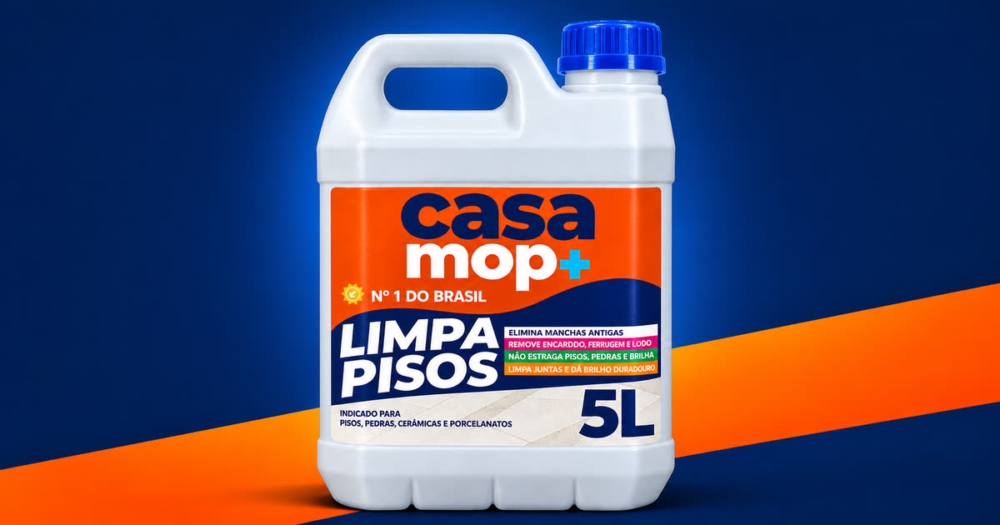

# Landing Page Casa Mop+

Landing page oficial do **Casa Mop+ Limpa Pisos**, disponibilizada para afiliados autorizados divulgarem o produto com seus próprios links de venda.

> **Afiliado:** baixe o projeto, substitua os seis links de checkout pelos seus links de afiliado e publique. A página já está pronta e não exige instalação, banco de dados ou processo de compilação.

[](https://casamop.com.br/)

## Página publicada

**Landing page:** https://casamop.com.br/

## O que você precisa alterar

Todos os links de compra estão centralizados no arquivo [`js/config.js`](js/config.js), dentro da lista `kits`.

Procure pelos seis campos chamados `url`:

```js
kits: [
  { id: "50ml", url: "COLE_AQUI_SEU_LINK_DE_AFILIADO" },
  { id: "1l", url: "COLE_AQUI_SEU_LINK_DE_AFILIADO" },
  { id: "5l", url: "COLE_AQUI_SEU_LINK_DE_AFILIADO" },
  { id: "2galoes", url: "COLE_AQUI_SEU_LINK_DE_AFILIADO" },
  { id: "3galoes", url: "COLE_AQUI_SEU_LINK_DE_AFILIADO" },
  { id: "6galoes", url: "COLE_AQUI_SEU_LINK_DE_AFILIADO" },
]
```

Substitua somente o conteúdo entre aspas de cada `url`. Mantenha a vírgula e os demais dados de cada oferta.

Cada identificador corresponde a um produto ou kit:

| Identificador | Oferta exibida na página |
|---|---|
| `50ml` | Frasco de 50 ml |
| `1l` | Frasco de 1 L |
| `5l` | Galão de 5 L |
| `2galoes` | Kit com 2 galões de 5 L |
| `3galoes` | Kit com 3 galões de 5 L |
| `6galoes` | Kit com 6 galões de 5 L |

Use o link de afiliado correspondente a cada oferta. Depois de editar, selecione cada kit na página e teste o botão **Comprar agora** antes de iniciar a divulgação.

## Como copiar o projeto

### Opção 1: criar seu próprio repositório

1. Clique em **Fork** no topo deste repositório.
2. Crie a cópia na sua conta do GitHub.
3. Abra `js/config.js` no seu repositório.
4. Clique no ícone de lápis para editar.
5. Troque os seis valores de `url`.
6. Salve em **Commit changes**.

Essa é a opção mais simples para publicar pela Vercel sem instalar ferramentas no computador.

### Opção 2: baixar o arquivo ZIP

1. Clique em **Code** no topo deste repositório.
2. Clique em **Download ZIP**.
3. Extraia o arquivo no computador.
4. Abra `js/config.js` em um editor de texto ou de código.
5. Troque os seis links de checkout.

### Opção 3: clonar com Git

```bash
git clone https://github.com/JohnGyn/casamop.git
cd casamop
```

Depois, edite `js/config.js` e substitua os campos `url`.

## Como testar no computador

O projeto usa apenas HTML, CSS e JavaScript. Se você tiver Python instalado, execute na pasta do projeto:

```bash
python3 -m http.server 5173
```

Abra http://localhost:5173 no navegador.

Também é possível usar uma extensão de servidor local, como **Live Server**, no editor de código.

## Como publicar na Vercel

1. Faça um **fork** deste repositório.
2. Entre em https://vercel.com/ com sua conta do GitHub.
3. Clique em **Add New → Project**.
4. Importe o repositório criado na sua conta.
5. Em **Framework Preset**, escolha **Other**.
6. Não preencha comando de build e mantenha a raiz do projeto como diretório de saída.
7. Clique em **Deploy**.

Quando você enviar novas alterações para a branch `main`, a Vercel publicará uma nova versão automaticamente.

Como o projeto é estático, ele também pode ser publicado no Netlify, Cloudflare Pages, hospedagem compartilhada, cPanel ou VPS com Nginx ou Apache. Publique todo o conteúdo do repositório e preserve a estrutura das pastas.

## Páginas de retorno do checkout

O projeto inclui páginas para os diferentes estados de pagamento:

| Situação | Caminho no seu domínio | Exemplo oficial |
|---|---|---|
| Pagamento aprovado | `/obrigado/` | https://casamop.com.br/obrigado/ |
| Pix gerado | `/obrigado/pix/` | https://casamop.com.br/obrigado/pix/ |
| Boleto gerado | `/obrigado/boleto/` | https://casamop.com.br/obrigado/boleto/ |
| Pagamento em processamento | `/obrigado/processando/` | https://casamop.com.br/obrigado/processando/ |

Ao publicar em outro domínio, troque apenas o domínio dos exemplos. Se a sua página estiver em `https://meusite.com.br`, a URL de pagamento aprovado será `https://meusite.com.br/obrigado/`.

Cadastre essas URLs no checkout correspondente a cada situação para que o comprador seja direcionado à página correta.

## Rastreamento

O projeto contém o Meta Pixel usado na página oficial:

- `PageView` é disparado na landing page e nas páginas de retorno;
- `Purchase` é disparado somente na página de pagamento aprovado;
- o evento `Purchase` usa `?value=` ou `?valor=` quando o checkout envia um desses parâmetros;
- a mesma compra não é contada novamente se a página for recarregada na mesma sessão.

O Pixel está configurado no [`index.html`](index.html) e nas páginas dentro de [`obrigado/`](obrigado/). Afiliados que precisarem usar um pixel próprio podem substituir essa configuração antes de publicar. Essa alteração é opcional para quem precisa apenas trocar os links de venda.

## Estrutura do projeto

```text
.
├── index.html              # landing page
├── js/
│   ├── config.js           # links de checkout e configurações principais
│   ├── main.js             # comportamento da landing page
│   └── thank-you.js        # rastreamento das páginas de retorno
├── css/                    # estilos da landing page e dos retornos
├── assets/img/             # imagens dos produtos e da página
└── obrigado/               # páginas de retorno do checkout
```

## Personalizações opcionais

| Alteração | Arquivo principal |
|---|---|
| Links de checkout, WhatsApp, ofertas, preços e parcelamento | `js/config.js` |
| Textos, seções, metadados e Pixel da landing page | `index.html` |
| Cores, fontes, espaçamentos e responsividade | `css/styles.css` |
| Conteúdo das páginas de aprovado, Pix, boleto e processamento | `obrigado/` |
| Estilo das páginas de retorno | `css/thank-you.css` |
| Rastreamento das páginas de retorno | `js/thank-you.js` |

Alterar preços, promessas, instruções de uso ou informações regulatórias pode deixar a página diferente da comunicação oficial do produto. Para divulgação como afiliado, a recomendação é trocar apenas os links de checkout.

## Uso do material

Este projeto é disponibilizado para divulgação do Casa Mop+ por afiliados autorizados. A marca, os textos, as imagens dos produtos e os demais materiais comerciais continuam pertencendo aos seus respectivos titulares.

Não remova informações obrigatórias do produto nem use a página para divulgar produtos de terceiros como se fossem o Casa Mop+.

## Suporte

Em caso de dúvida sobre cadastro, aprovação ou geração dos links de afiliado, fale com o responsável pelo programa de afiliados do Casa Mop+.
